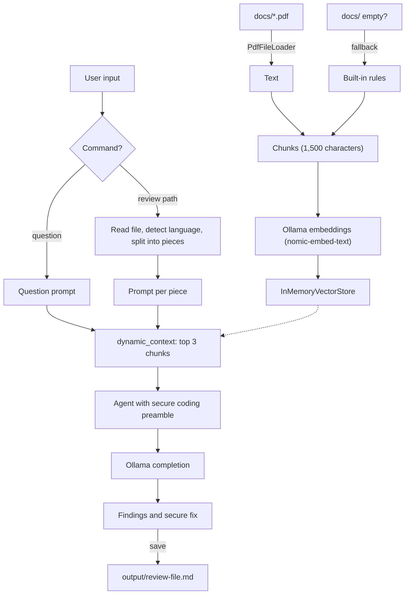

# Secure Coding Support RAG

A local, privacy-first secure coding assistant built in Rust on the [Rig](https://github.com/0xPlaygrounds/rig) framework, with [Ollama](https://ollama.com/) as the model host.

It does one job: help developers write secure code. You ask a secure coding question, or point it at a source file. It explains the risks and shows a safer version.

Everything runs on your machine. It needs no API keys, no telemetry and no cloud service.

---

## Features

- **Question mode.** Ask any secure coding question in plain text.
- **File review mode.** `review <path>` reads a source file, detects the language from the file extension, and reviews it piece by piece (60 lines at most per piece, never mid-line).
- **Retrieval-augmented answers (RAG).** Each request pulls the 3 most similar guideline chunks from your own knowledge base and gives them to the model.
- **Your own knowledge.** Put secure coding standards, OWASP cheat sheets and language guidelines as PDF files in `docs/`. They are loaded, chunked and embedded at startup.
- **Built-in fallback.** If `docs/` is missing or has no readable PDF, the app uses 12 built-in secure coding rules (SQL injection, XSS, password storage, input validation, secrets, path traversal, deserialization, command injection, access control, cryptography, logging, TLS).
- **Fixed answer format.** Every answer has four sections: *Findings* (issue, line, risk, CWE or OWASP category), *Secure fix*, *Why it works*, *How to verify*.
- **Honest output.** Lines that come only from the model are marked `(model knowledge)`. Unsure items say `needs review`. Safe code is reported as safe. The model must not invent CVE IDs or write working exploit payloads.
- **Save reviews.** `save` writes the last review to `output/review-<file>.md`.
- **Model choice.** Set `EMBED_MODEL` and `COMPLETION_MODEL` to use other Ollama models.
- **Memory-safe code.** The project uses `#![forbid(unsafe_code)]`.

## Tech stack

| Component | Technology | Role |
| :--- | :--- | :--- |
| Language | Rust (2021 edition) | Memory-safe systems language |
| LLM framework | [Rig](https://github.com/0xPlaygrounds/rig) 0.44 (features `derive`, `pdf`) | `AgentBuilder`, `EmbeddingsBuilder`, `PdfFileLoader`, `InMemoryVectorStore`, Ollama client |
| LLM host | [Ollama](https://ollama.com/) on port 11434 | Runs the models locally |
| Embedding model | `nomic-embed-text` | 768-dimension embeddings |
| Completion model | `CyberCrew/notmythos-8b:latest` | Local security-tuned model (Ollama reports 3.2B parameters, 131072 context) |
| Vector store | `InMemoryVectorStore` | Cosine similarity search, rebuilt at each start |
| Async runtime | Tokio 1 (`full`) | Async runtime |
| Serialization | Serde 1 | Derive for the `Document` type |
| Error handling | Anyhow 1 | Errors with context |
| File I/O | `std::fs`, `std::io` | Source files, stdin, saved reviews |

Dependencies in `Cargo.toml`: `rig`, `anyhow`, `serde`, `tokio`. Nothing else.

## Architecture



### Pipeline

1. **Load.** `PdfFileLoader` reads `docs/*.pdf`. If nothing loads, the built-in rules are used.
2. **Chunk.** `chunk_text` splits on whitespace into chunks of at most 1,500 characters.
3. **Embed and index.** Each chunk becomes a `Document { id, content }`, is embedded, and is stored in the in-memory vector store.
4. **Prepare input.** A question becomes a question prompt. A file is read with `std::fs`, its language is detected, and the code is split into pieces of at most 60 lines. Line numbers stay correct across pieces.
5. **Retrieve.** `dynamic_context(3, index)` finds the guideline chunks closest to the prompt.
6. **Answer.** The agent applies the secure coding preamble (temperature 0.1, `num_ctx` 8192) and answers in the four sections.
7. **Output.** The answer prints to the terminal. `save` writes it as Markdown.

## Project structure

```
secure-coding-agent/
├── docs/                    # Your secure coding PDFs (knowledge base)
├── output/                  # Saved reviews (git-ignored)
├── src/
│   ├── main.rs              # Ingestion, index, agent, CLI loop
│   └── review.rs            # Language detection, code splitting, prompt builders
├── tests/samples/
│   ├── flawed/              # 10 files with known flaws
│   └── safe/                # 3 safe files
├── Cargo.toml
├── Cargo.lock
├── progress_tracker.md      # Build checklist (ASD-STE100 style)
├── SECURE_CODING_SUPPORT_RAG_PLAN.md
└── README.md
```

## Setup

1. Install Rust and [Ollama](https://ollama.com/).
2. Pull the models:

   ```
   ollama pull nomic-embed-text
   ollama pull CyberCrew/notmythos-8b:latest
   ```

3. Put your secure coding PDFs in `docs/`. The repo includes one short guide, `docs/secure-coding-quick-guide.pdf`. Replace it or add to it with real standards.

## Usage

Run from the project root, so the app can find `docs/`:

```
cargo run
```

Or build and run the optimized binary:

```
cargo build --release
.\target\release\secure-coding-support-rag.exe
```

| Command | Action |
| :--- | :--- |
| any text | Ask a secure coding question |
| `review <path>` | Review a source file, piece by piece |
| `save` | Save the last review to `output/review-<file>.md` |
| `exit` | Quit |

Example:

```text
Loaded 1 security chunks.
Successfully generated embeddings
Starting secure coding support chatbot (completion model: CyberCrew/notmythos-8b:latest)...
> review tests/samples/flawed/sqli.py
[1/1] lines 1-5
### Findings
The affected line is `query = "SELECT * FROM users WHERE name = '" + name + "'"`. Risk: SQL injection (CWE-89).
### Secure fix
...
> save
Saved output/review-sqli-py.md
```

## Supported languages

Detected from the file extension: Python, Rust, JavaScript, TypeScript, Java, Kotlin, Go, C, C++, C#, PHP, Ruby, Swift, Shell, SQL and PowerShell. Other files are still reviewed, as "unknown language".

## Testing

```
cargo test
```

18 unit tests cover chunking, the built-in fallback, file reading, language detection, code splitting, prompt building and file-name slugs.

`tests/samples/flawed/` holds 10 small files with known flaws: SQL built by string concatenation, plain-text password storage, hard-coded secret, unvalidated file path, unsafe deserialization, OS command injection, cross-site scripting, weak password hash, insecure randomness, and disabled TLS verification. `tests/samples/safe/` holds 3 safe files. Run `review` on each file to check the agent.

## Outcome

Last test run, on the 13 sample files:

| Check | Result |
| :--- | :--- |
| Flaws found | 10 of 10 |
| Suggested fixes are valid code | 13 of 13 (syntax check only; no fix was run) |
| Safe code left alone | 1 of 3 (2 were falsely flagged) |
| Answers follow the four sections | Yes |

Build status: `cargo test` passes, `cargo clippy` has no warnings, `cargo fmt --check` passes. The release binary is about 10 MB.

Known gaps are in `progress_tracker.md`:
- The model sometimes flags safe code.
- Chunk size and top-N are not tuned yet, because `docs/` holds only one PDF (1 chunk).

## Limits

An 8B-class model is not a static analyser. It can miss flaws, flag safe code, and suggest fixes that need changes. Test every fix. Keep using a SAST tool and human code review.

## Progress

See `progress_tracker.md` for the full build checklist.
