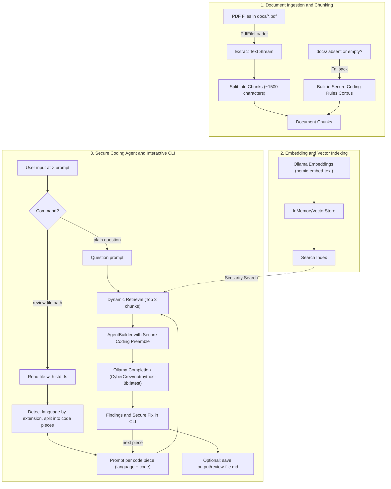

# Secure Coding Support RAG

A new, standalone project: a local Rust agent built with the [Rig](https://github.com/0xPlaygrounds/rig) framework and [Ollama](https://ollama.com/) that does **one job**: help developers write secure code. You ask a secure-coding question, or point it at a source file, and it explains the risks and shows a safer version.

It is separate from Security RAG, Security Doc RAG and CVE Explanation Security RAG: its own repo, its own `docs/` knowledge, its own index. It uses two knowledge sources only:

1. **Document knowledge:** chunks from this project's own `docs/*.pdf` (secure coding standards, OWASP cheat sheets, language-specific guidelines saved as PDF).
2. **Model knowledge:** `CyberCrew/notmythos-8b:latest` through Ollama.

Everything runs 100% locally. No external API keys, telemetry or cloud services.

---

## Architecture & Workflow



### Detailed Pipeline Stages

1. **Document Loading:** at startup the app loads `docs/*.pdf` with `rig::loaders::PdfFileLoader`. If `docs/` is missing or empty, it falls back to a small built-in corpus of core secure coding rules (parameterized queries, output encoding, password hashing, input validation, no secrets in code) so it still runs.
2. **Word-Boundary Chunking:** text is split by `chunk_text` on whitespace into chunks of at most 1,500 characters, so one chunk usually covers one rule or guideline.
3. **Vector Embeddings:** each chunk becomes a `Document { id, content }` and is embedded through `EmbeddingsBuilder` with `nomic-embed-text`.
4. **In-Memory Vector Store:** embeddings are held in an `InMemoryVectorStore` and searched by cosine similarity.
5. **Two input modes:** a plain question (`How do I store passwords safely in Python?`) or `review <path>`. Plain Rust reads the file with `std::fs`, detects the language from the file extension and splits the code into pieces of at most about 60 lines, so each request fits the 8B model's context.
6. **Prompt per piece:** the prompt states the language and holds the code piece, so `dynamic_context(3, index)` retrieves the guideline chunks closest to what the code does (for example SQL building or password handling).
7. **Secure Coding Preamble:** answer in fixed sections: *Findings* (issue, the affected line, risk, CWE or OWASP category), *Secure fix* (corrected code), *Why it works*, *How to verify* (a test or check). Use retrieved context first. Mark lines that come only from the model as `(model knowledge)`. If the code looks safe, say so and do not invent issues. Never produce working exploit payloads. When unsure, write `needs review`.
8. **Output:** results print to the CLI per piece, with an optional `save` command that writes `output/review-<file>.md` using `std::fs`.

---

## Tech Stack & Dependencies

| Component | Technology | Description |
| :--- | :--- | :--- |
| **Language** | Rust (2021 Edition) | Memory-safe systems language (`forbid(unsafe_code)`) |
| **LLM Framework** | [Rig](https://github.com/0xPlaygrounds/rig) (v0.44, features `derive`, `pdf`) | `AgentBuilder`, `EmbeddingsBuilder`, `PdfFileLoader`, `InMemoryVectorStore` |
| **LLM Host** | [Ollama](https://ollama.com/) | Local runner on port 11434 |
| **Embedding Model** | `nomic-embed-text` | 768-dimensional embeddings |
| **Completion Model** | `CyberCrew/notmythos-8b:latest` | Local security-tuned model |
| **Vector Store** | `InMemoryVectorStore` | Ephemeral in-memory index |
| **Async Runtime** | Tokio (v1, full) | Asynchronous runtime |
| **Serialization** | Serde | Derive for `Document` |
| **Error Handling** | Anyhow | Context-rich errors |
| **File I/O** | `std::fs`, `std::io` | Reads source files, reads stdin, writes review notes |

`Cargo.toml` uses the same dependencies as the other projects: `rig`, `anyhow`, `serde`, `tokio`. Nothing else.

---

## File Structure

```
secure-coding-support-rag/
├── docs/                   # Your secure coding PDFs (own knowledge)
│   └── *.pdf
├── output/                 # Saved reviews (git-ignored)
├── src/
│   ├── main.rs             # Ingestion, index, agent, CLI loop
│   └── review.rs           # Language detection, code splitting, prompt builder
├── Cargo.toml
├── Cargo.lock
├── .gitignore              # target/ and output/
└── README.md
```

Run: `cargo run`, then ask a question or type `review src/login.py`.

---

## Implementation Phases

1. **Project setup (0.5 day):** `cargo new secure-coding-support-rag`, copy the dependency block, add `docs/` and `output/`, pull `nomic-embed-text` and `CyberCrew/notmythos-8b:latest`. Confirm against Rig 0.44 that `AgentBuilder` accepts `.temperature()` and `.additional_params()` (Ollama `num_ctx`), and that `agent.prompt()` works with `dynamic_context`. Run `ollama show` on the model to see its real context length.
2. **Ingestion and index (1 day):** `chunk_text` (1,500 characters), PDF loading with the built-in rules fallback, embedding and `InMemoryVectorStore`, with unit tests for chunking.
3. **Review helpers (1 day):** in `review.rs`, language detection from the file extension, line-based code splitting (about 60 lines per piece, never mid-line), and the prompt builder. Unit tests for all three.
4. **Secure coding agent (1.5 days):** `AgentBuilder` with the secure coding preamble, `dynamic_context(3, index)`, low temperature (about 0.2), `num_ctx` 8192.
5. **CLI (1 day):** a Rust stdin loop (the repo's `ChatBotBuilder` reads one line only, so file review needs its own loop). Plain text calls `agent.prompt()`; `review <path>` loops over the pieces; `save` writes the markdown; `exit` quits. Check whether Rig 0.44 chat history is worth adding for follow-up questions.
6. **Test and tune (1 day):** run 10 small code samples with known flaws (SQL built by string concatenation, plain-text password storage, hard-coded secret, unvalidated file path, unsafe deserialization) and 3 safe samples. Check that flaws are found, safe code is not flagged, and fixes compile. Tune chunk size, top-N, piece size and temperature, then write the README.

---

## Expected Outcome

```text
Loaded 31 security chunks.
Successfully generated embeddings
Starting secure coding support chatbot (completion model: CyberCrew/notmythos-8b:latest)...
> review src/login.py
[1/2] lines 1-58
Findings: SQL query built with string concatenation (line 23). Risk: SQL injection (CWE-89).
Secure fix: use a parameterized query ...
Why it works: ...
How to verify: ...
> save
Saved output/review-login-py.md
```

- Findings and a corrected version for each code piece, grounded in this project's PDFs.
- Model-only lines marked `(model knowledge)`; uncertain ones say `needs review`.
- Fully local, Rig and Rust only, independent of the other projects.

> [!NOTE]
> This is an 8B model reviewing code, not a static analyser. It can miss flaws and suggest fixes that need adjusting, so test every fix and keep using a SAST tool and human code review.
